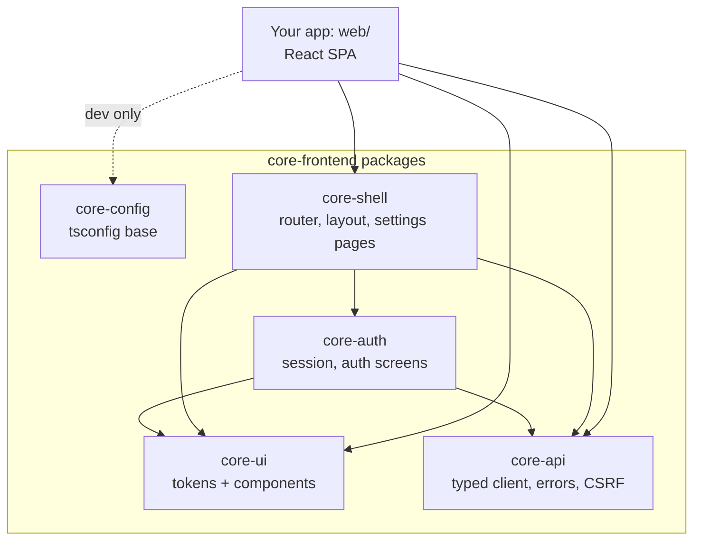
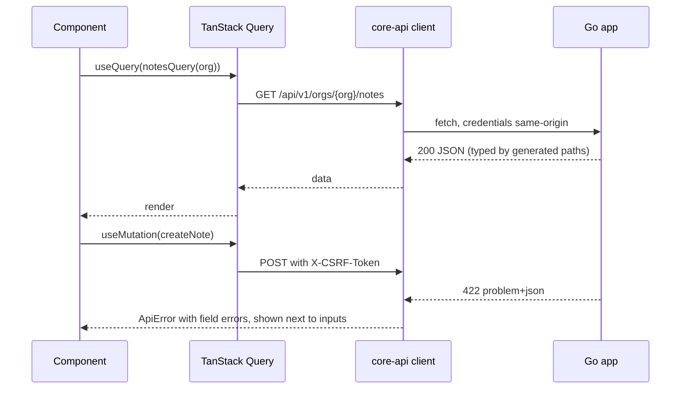

# Frontend architecture

How `core-frontend` is organized and how an app uses it. The backend side of the same app is described in
`core-backend/docs/architecture.md`.

## Shape of an app's frontend

Each app has one React single-page app ([ADR 0001](adr/0001-react-spa-only.md)):

| | |
|---|---|
| Path | `/app/*`; `/` redirects to `/app/` until a public site exists |
| Built with | React + Vite |
| Served by | The app's Go binary, which embeds the build |
| Data | The app's API at `/api/v1`, same origin, session cookie |

Public, SEO-oriented pages are not part of this repository. They will come from a separate `core-site`
repository later.

## Packages

All packages are published as `@mahrus-rohisyam/core-*` and share one version
([ADR 0002](adr/0002-npm-workspace-packages.md)).



| Package | Contents |
|---|---|
| `core-config` | `tsconfig.base.json` (strict, `noUncheckedIndexedAccess`, bundler resolution) |
| `core-ui` | `tokens.css` (light and dark), `styles.css`, and components on native elements: `Button`, `TextField`, `SelectField`, `Checkbox`, `Alert`, `Card`, `PageHeader`, `Table`, `Dialog`, `Badge`, `EmptyState`, `Spinner` |
| `core-api` | `createApiClient<paths>()` on openapi-fetch, `unwrap`, `ApiError` from problem+json, the CSRF header, `CorePaths` types generated from the backend |
| `core-auth` | `SessionProvider`, `useSession`, `useSignOut`, query options for routers, and the forms: sign-in (with two-factor step), sign-up, forgot and reset password, verify email; `FormError` and `fieldError` for any form |
| `core-shell` | `createCoreApp` (router, query client, providers), the layout with sidebar and organization switcher, account settings, organization settings (general, members, roles, invitations, API tokens, audit log), `useOrg`, `useCan` |

Import rules:

| Package | May import |
|---|---|
| `core-ui` | React, nothing else from the core |
| `core-api` | openapi-fetch, nothing else from the core |
| `core-auth` | `core-ui`, `core-api`, TanStack Query |
| `core-shell` | `core-ui`, `core-api`, `core-auth`, TanStack Query and Router |

## How an app composes the SPA

`core-shell` owns the router. The app passes its own routes, which hang under `/orgs/$org`, and its
sidebar entries:

```tsx
const { App } = createCoreApp({
  appName: "Notes",
  nav: [{ to: "notes", label: "Notes", permission: "notes.read" }],
  routes: (orgRoute) => [
    createRoute({
      getParentRoute: () => orgRoute,
      path: "notes",
      component: lazyRouteComponent(() => import("./notes"), "NotesPage"),
    }),
  ],
});
```

| Route | Page |
|---|---|
| `/sign-in`, `/sign-up`, `/forgot-password` | Sign-in screens. The first visit to a new instance goes to sign-up |
| `/reset-password`, `/verify-email`, `/accept-invitation` | Targets of the links in the backend's emails (`?token=...`) |
| `/` | Redirects to the user's first organization |
| `/account` | Profile, password, two-factor authentication, sessions |
| `/orgs/$org` | The organization layout; the app's pages live under it |
| `/orgs/$org/settings/$tab` | `general`, `members`, `roles`, `invitations`, `api-tokens`, `audit` |

Pages that need a session redirect to `/sign-in?next=...` in the route's `beforeLoad`; after sign-in
the user returns to `next`, which must be a path inside the app.

## Data flow



- Server data lives in TanStack Query. Keys start with `["orgs", orgId]` for organization data, so one
  invalidation refreshes everything in an organization.
- The CSRF token comes with the session (`GET /api/v1/session`) and is kept in memory only.
- A `401` from any call except sign-in clears the session and re-runs the route guards, which send the
  user to sign-in.
- The sidebar hides entries the user lacks the permission for. The API enforces permissions regardless.

## Theming and branding

Apps set their brand in one CSS file that overrides tokens
([ADR 0004](adr/0004-plain-css-tokens-native-elements.md)):

```css
/* web/src/theme.css, imported after the core styles */
:root { --color-brand: oklch(0.5 0.15 160); }
@media (prefers-color-scheme: dark) { :root { --color-brand: oklch(0.75 0.13 160); } }
```

## Performance budget

| Measure | Target | Example app today |
|---|---|---|
| JavaScript for the first screen | under 200 KB gzipped | 113 KB |
| CSS | under 20 KB gzipped | 2 KB |
| Route chunks | each feature and settings page lazy-loaded | account, settings and notes are separate chunks |

## Accessibility

- Every input has a label; hints and errors are linked with `aria-describedby`, and errors are announced.
- Dialogs use the native `<dialog>` element, which traps focus and returns it on close.
- Focus is always visible. Token colors were chosen for WCAG AA contrast in both themes; an automated
  contrast check is planned with the end-to-end tests.
- The layout works down to phone width; the sidebar becomes a menu.

## Security

- The session is an `HttpOnly` cookie; no token is stored where JavaScript can read it.
- Every state-changing request carries the CSRF token; the backend also checks `Origin`.
- No `dangerouslySetInnerHTML`; user content is rendered as text.
- The built app runs under the backend's strict CSP: no inline scripts, styles only from files.
- After sign-in, only paths inside the app are accepted as the return address.
- Email links (verify, reset) wait for a click instead of acting on page load, because mail scanners
  open links.

## Building and embedding

| Step | Output | Served at |
|---|---|---|
| `vite build` with `base: "/app/"` | `web/dist/` | `/app/*` |
| `go build` embeds it via `embed.FS` | one binary | |

Hashed asset files are cached for a year; `index.html` is not cached.

## Testing

| Level | Tool | Where |
|---|---|---|
| Units and hooks | Vitest | each package |
| Components | Vitest with jsdom and Testing Library | `core-ui`, `core-auth` |
| End to end | Playwright against the real Go app *(planned in `app-template`)* | |

## Repository layout

```
core-frontend/
├── packages/
│   ├── core-config/  core-ui/  core-api/  core-auth/  core-shell/
├── examples/app/     the "notes" SPA, against core-backend's example app
├── package.json      npm workspaces and scripts
├── .npmrc            dependency policy (exact versions, release age, no install scripts)
└── docs/
```
