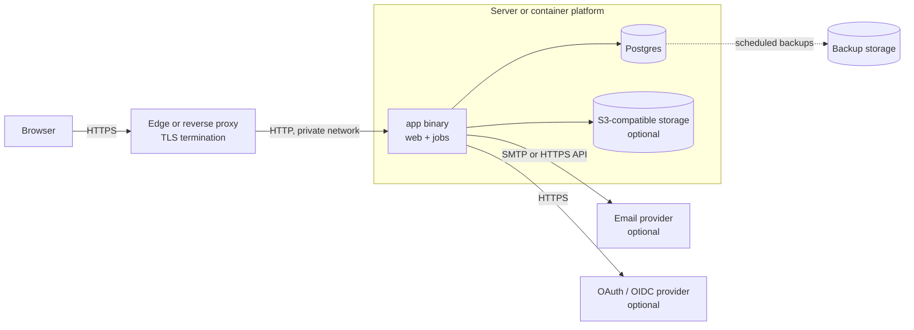
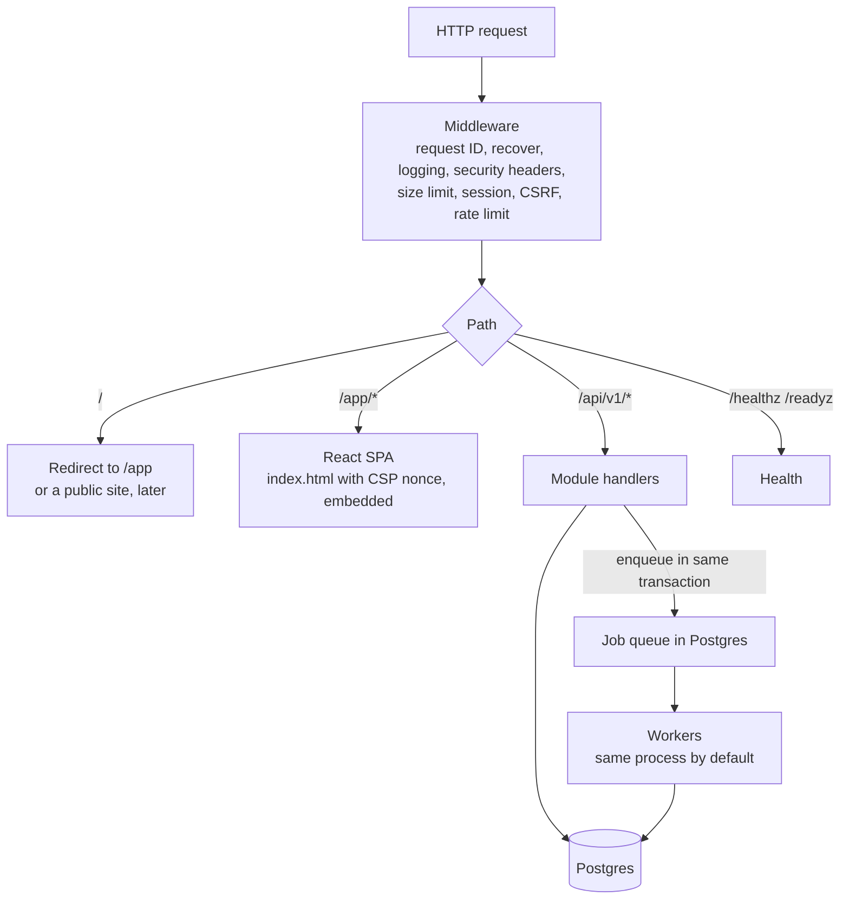
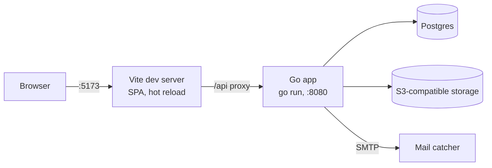

# Topology

Where an app built on the core runs, and what talks to what. The app is one binary
([ADR 0002](adr/0002-modular-monolith-single-binary.md)) with Postgres as its only required datastore
([ADR 0003](adr/0003-postgres-only-datastore.md)).

> **Required vs suggested.** Only the app binary and Postgres are required. Named products in this
> document (Cloudflare, Caddy, MinIO, Mailpit, Resend, and so on) are **suggestions** that are known to
> work. Use whatever your team already runs, as long as it meets the requirement in the same row.

## Production

| Component | Required? | Requirement | Suggestions |
|---|---|---|---|
| Edge / reverse proxy | Yes, in front of the app | Terminates TLS 1.2+, forwards to the app over a private network, passes `X-Forwarded-For` and `X-Forwarded-Proto` | Caddy, nginx, Traefik, a cloud load balancer, or Cloudflare (proxy or Tunnel) |
| app | Yes | Runs the binary as a non-root user; listens on a private address, not a public interface | Distroless container image on Docker, Podman, Kubernetes, or a systemd service |
| Postgres | Yes | Version 17 or newer, reachable only from the app | Self-hosted container, or a managed service (RDS, Cloud SQL, Neon, Supabase) |
| Object storage | Only for apps that store files | S3 API | MinIO or Garage (self-hosted), AWS S3, Cloudflare R2, Backblaze B2 |
| Email | Only for apps that send email (sign-up verification, password reset) | SMTP, or a provider supported by the `mail` package | Any SMTP server, Resend, Postmark, Amazon SES |
| OAuth / OIDC | Only for social or company sign-in | OpenID Connect | Google, Microsoft Entra ID, Keycloak |
| Backups | Yes, for real data | Regular `pg_dump` or point-in-time recovery, stored off the host, restore tested | Your provider's backups, pgBackRest, WAL-G |

Caching at the edge is optional. If you use it, cache only hashed static files (`/app/assets/*`),
never HTML or `/api/*`.

### Inside the app binary

### Scaling path

1. One process, `app serve` (web and jobs). Enough for most small and medium apps.
2. Split jobs out: run `app web` and `app worker` as two processes from the same image.
3. Run several `app web` copies behind the proxy. Sessions, rate limits and jobs are in Postgres, so no
   sticky sessions are needed.

## Development

- `make up` starts the development datastores in Docker, bound to `127.0.0.1`. The template uses
  Postgres, MinIO (S3) and Mailpit (mail catcher); swap them in `compose.dev.yml` if you prefer others.
- `make dev` runs the Go app and the Vite dev server. Vite proxies `/api` to Go, so the browser sees one
  origin and cookies behave as in production.
- `make app` builds the production image and runs it locally, to check the embedded build.
- A mail catcher receives every outgoing email in development; nothing reaches real inboxes.

## Environments

| Environment | Database | Mail | Data |
|---|---|---|---|
| Development | local container | mail catcher | generated seed data |
| Test (`make test`, CI) | throwaway database per run | in-memory sender | created by each test |
| End to end (`make e2e`) | fresh database, app on its own port | mail catcher | created by the tests |
| Production | the app's own database | your email provider | real |

## Ports

Suggested defaults, chosen to avoid the standard ports of tools you may already run. Change them in
`.env` if they clash.

| Service | Development | Production |
|---|---|---|
| app | 8080 | your choice, behind the proxy |
| Postgres | 55432 | not published |
| S3 API / console | 59000 / 59001 | not published |
| Mail catcher SMTP / web | 51025 / 58025 | not used |
| Vite dev server | 5173 | not used |
